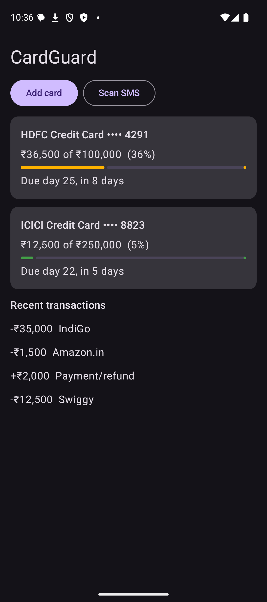
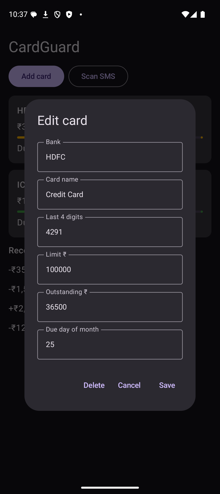

# CardGuard

Offline, privacy-first credit card tracker for Android. It reads bank transaction SMS on the device, keeps balances and utilization up to date, and reminds you before a due date. No internet permission, no bank login, no analytics, no cloud sync.

Built for Indian credit card holders (HDFC, ICICI, SBI, Axis, Amex, Kotak and similar SMS formats).

| Dashboard | Edit card |
|---|---|
|  |  |

## Features

- **Automatic SMS tracking**: incoming bank SMS are parsed for debits, payments and refunds, then applied to the matching card (by last 4 digits). Unknown cards are created automatically.
- **Scan SMS**: one-tap import of existing inbox messages.
- **Utilization bars**: per card, colored green / amber / red (under 30%, 30-75%, over 75%).
- **Due-date reminders**: a daily WorkManager job notifies from 5 days before the due day through the due day, and stops once the outstanding balance is 0.
- **Duplicate filtering**: the same SMS received twice within a minute is recorded once.
- **Manual control**: add, edit and delete cards, correct balances and limits.
- **Offline by design**: the manifest declares only `READ_SMS`, `RECEIVE_SMS` and `POST_NOTIFICATIONS`. No `INTERNET` permission. Backup is disabled.

## Stack

Kotlin, Jetpack Compose (Material 3), Room, WorkManager. Min SDK 26, target SDK 35.

| File | Role |
|---|---|
| `SmsParser.kt` | Pure parser for bank SMS (unit tested) |
| `Data.kt` | Room entities, DAO, and the `ingest` pipeline |
| `SmsReceiver.kt` | Live SMS receiver and inbox import |
| `ReminderWorker.kt` | Daily due-date notifications |
| `MainActivity.kt` | Compose dashboard and card dialog |

## Build

Requires JDK 17 and the Android SDK.

```bash
./gradlew testDebugUnitTest assembleDebug
```

The APK lands in `app/build/outputs/apk/debug/`. `gradle.properties` pins `org.gradle.java.home` to a local JDK 17 path; change it to match your machine, or remove it if `JAVA_HOME` already points to JDK 17 (Kotlin 2.0 cannot parse a JDK 25 version string).

To try it on an emulator, grant the SMS permissions, then inject a message:

```bash
adb emu sms send HDFCBK "Spent Rs.1,500.00 on your HDFC Bank Card ending 4291 at Amazon.in on 12-06-25."
```

## Status

Early MVP. Working: SMS parsing, storage, dashboard, reminders.

Not yet built:

- At-rest database encryption (plain Room today; SQLCipher is the planned swap)
- App lock (PIN / biometrics)
- Stealth notifications (masked amounts)
- Monthly spend insights and best-card suggestion
- EMI and partial-payment handling
- Parsing coverage for more bank formats

Parsing is regex-based and tuned to common formats; if a bank's SMS is missed, add a case to `SmsParserTest` and extend `SmsParser`.

## Privacy

All data stays in the app's private storage on the device. Nothing is sent anywhere.
